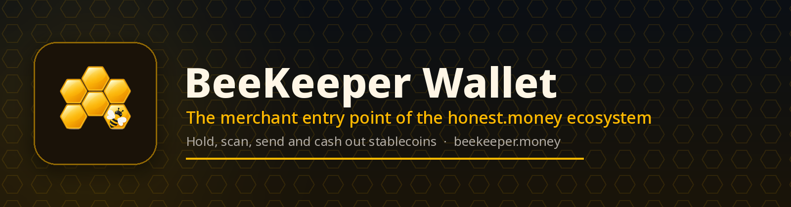

<p align="center">
  
</p>

<p align="center">
  <strong>Self-custody wallet for merchants.</strong><br />
  Hold, scan, send and cash out stablecoins — no accounts, no custody,
  no middlemen holding your keys.
</p>

<p align="center">
  <a href="https://beekeeper.money"></a>
  <a href="https://honest.money"></a>
  
  
</p>

<p align="center">
  <a href="https://beekeeper.money">Open the wallet</a> ·
  <a href="#what-it-does">What it does</a> ·
  <a href="#cash-out">Cash out</a> ·
  <a href="#top-up">Top up</a> ·
  <a href="#security">Security</a> ·
  <a href="#development">Development</a>
</p>

> [!IMPORTANT]
> This project is connected to [Lovable](https://lovable.dev). Avoid rewriting
> published git history — force pushing, or rebasing/amending/squashing commits
> that are already pushed — as it rewrites history on Lovable's side and the
> user will likely lose their project history.
>
> Commits you push to the connected branch sync back to Lovable and show up in
> the editor, so keep the branch in a working state.

## What this is

BeeKeeper is the **merchant entry point** of the honest.money ecosystem. A merchant
opens it, scans a Copper Coin to activate, sets a device password, and from then on
the browser tab _is_ their wallet: balances across every chain in one total, a scan
box that reads payment requests, and one-tap cash out to a bank account.

It is deliberately small. BeeKeeper holds keys, shows balances, signs transactions
and hands stablecoins to a partner that pays out to a bank. Everything else —
identity checks, bank linking, pricing, settlement, swapping, bridging — belongs to
another service in the ecosystem, and BeeKeeper stays out of it.

**Live:** <https://beekeeper.money> · **Preview alias:** <https://beekeeper-wallet.lovable.app>

### What it is not

| Not in BeeKeeper                             | Where it goes instead                                             |
| -------------------------------------------- | ----------------------------------------------------------------- |
| Swaps and bridges                            | [Honest Money Wallet](https://honest.money)                       |
| Native phone apps (no iOS, no Android build) | Honest Money Wallet for mobile                                    |
| Identity / KYC / bank linking                | [VectorPay](https://honest.money) at cash-out time                |
| TSD → USDC off-ramp, TSD Swap API key        | VectorPay cash-out roundup                                        |
| Recovery-phrase generation for newcomers     | Cold Storage Coin — the wallet is for someone with a coin to scan |

---

## What it does

### One total across every chain

The homepage adds up everything the wallet can actually spend: native coins,
built-in stablecoins, and the first **20 derived addresses** on each EVM chain, so
funds parked on later addresses still show in the total.

| Chain                         | Coins          | Stablecoins counted                       |
| ----------------------------- | -------------- | ----------------------------------------- |
| TEXITcoin (TXC)               | TXC            | TSD (Omni layer-2, counted at $1)         |
| Ethereum                      | ETH            | USDC, USDT, PYUSD, DAI                    |
| Base                          | ETH            | USDC, USDT, DAI                           |
| BNB Smart Chain               | BNB            | USDC, USDT, DAI                           |
| Zero Chill (ZCU)              | ZCU            | custom ERC-20s (no canonical stables yet) |
| TRON                          | TRX            | USDT                                      |
| Bitcoin / Litecoin / Dogecoin | BTC, LTC, DOGE | —                                         |
| Solana                        | SOL            | —                                         |
| ISK                           | ISK            | —                                         |

Address derivation follows the ecosystem's coin types: TXC at `m/44'/696969'`,
ISK at `m/44'/969696'`.

### Scan-first, not type-first

Activation is **BeeKeeper Coin Scan → Rules → Password**. A merchant with a coin to
scan is onboarded in one flow; there is no recovery-phrase prompt on the setup
screen. A strong device password protects the encrypted wallet, biometrics are
optional where the browser supports them, and legacy import (old BeeKeeper
encrypted wallets, WIF keys, backup files) is code-complete but currently switched
off for new users — flip `SHOW_LEGACY_IMPORT` in `src/lib/legacy-beekeeper.ts` to
bring it back.

### Ecosystem link

One Settings section holds every partner connection: paste a link URL, or scan a QR,
and the wallet routes it to the right protocol. Linked apps are listed in one place
with a clean unlink for each — NectarPay, TSD Swap account links (watch-only keys),
streamTXC, and VectorPay.

---

## Cash out

Cash out turns whatever stablecoins the wallet is holding into money in a bank
account. BeeKeeper **gathers the crypto and proves it is yours**; VectorPay owns
identity checks, bank linking, pricing and settlement.

**Assets:** TSD on TEXITcoin, USDC and USDT on Ethereum / Base / BNB Chain, USDT on
TRON. **Order size:** $1 – $1,000. **Fee:** 1% standard, 0% for NectarPay merchants.

### The flow

```text
0  VectorPay linked?   no → onboarding first (QR / code / deeplink)
1  Fee + bank summary  "Send $X to your Chase ending in 1234"
2  Pick assets         All / None, or edit any line down to a partial amount
3  Disclosures + order created with VectorPay
4  Send, one line at a time   retry or skip a failed line; the order uses what landed
5  Confirmation        "view my cash out status on VectorPay"
```

**One tap** is the default: it picks the largest balances first, caps at the $1,000
order maximum, skips lines that cannot pay their own network fee and Ethereum
balances under $10, and sends. The step-by-step picker is still there underneath and
runs the **same** order, send and confirm functions — one code path for money
movement.

### How a deposit gets attributed to you

VectorPay uses **one shared deposit address per chain**, so your money is never
matched by amount. A deposit is credited only when the order carries its **txid**
_and_ a **signature from the sending address** over the proof message
([`docs/vectorpay-cashout-proof.md`](docs/vectorpay-cashout-proof.md)). A duplicated
txid cannot credit twice.

### Where the numbers come from

Amounts are settled **server-side from the chain** before an order is signed to
VectorPay (`src/lib/cashout/verify.server.ts`). The wallet's own figures may only
_lower_ a line, never raise it. TSD settles from our own TEXITcoin node
(`omni_gettransaction`, `valid: true` + 3 confirmations); EVM lines settle from a
receipt at 12 confirmations. The public explorer is never the authority — a node
that cannot answer leaves a line unsettled rather than settling it.

---

## Top up

Top-up puts money _in_: the customer gets a permanent US bank account number and
routing number in their name; a deposit there is converted and delivered as **TSD**.
BeeKeeper owns the Bridge relationship (Bridge, the stablecoin banking company),
and the fee is **3%**.

**Status:** sandbox. On the live site the button reads **Top up · soon** and is
disabled — merchants never see test account numbers. Five quick taps on that button
reveal the sandbox flow for that visit only (`src/lib/bridge/visibility.ts`). Live
deposit accounts are refused until the TSD bridge team supplies a per-customer mint
address, so real USDC cannot land somewhere unplanned.

Going live is a checklist, not a code change: [`docs/bridge-go-live.md`](docs/bridge-go-live.md).

---

## Architecture

TanStack Start (React 19, Vite 7) on Cloudflare Workers, with Lovable Cloud
(Supabase) for the database and auth. No Edge Functions — app-internal server logic
uses `createServerFn`, and anything an external party calls is a route under
`src/routes/api/`.

```text
src/
  routes/            pages + every API surface (api/, api/public/)
  lib/
    chains/          EVM chains, ERC-20 catalogs, address derivation + scanning
    cashout/         one-tap plan, roundup, signed proofs, server-side settlement
    bridge/          Bridge client, fees, webhooks, top-up proofs, visibility
    txc/ isk/ btc/ ltc/ doge/ tron/ solana/ utxo/   per-chain wallet logic
    nectar/ rewards/ vectorpay*                     partner integrations
    security/        proxy guard, keyed limits, single-use nonces
    profiles.ts      per-wallet storage namespacing
    native/          trusted origins, platform bridge, capabilities
docs/                audit reports, partner API notes, go-live checklists
```

**Server routes.** `api/public/` is reachable without a session, so each handler
verifies its caller itself: `vectorpay-order-status.ts` (HMAC-signed order status),
`bridge.webhook.ts` (RSA-verified Bridge notices), `apk.ts` + `latest-release.ts`
(legacy installs), `build-id.ts`. The pass-through partners under `api/`
(`nectar.link`, `nectar.pay.$invoiceId`, `tsd.link`) all go through
`src/lib/security/proxy-guard.ts` — trusted host, documented URL shapes only, rate
limited, own-app POSTs, capped bodies — and answer through `relayJson`: no
redirects, JSON only.

**Trust is one file.** `src/lib/native/origins.ts` is the single source of truth for
every origin the app trusts: `PROD_ORIGIN` (`https://beekeeper.money`), its
`PROD_ALIASES`, and the native WebView origin. The bridge target, CSP, CORS
allowlist and API caller checks all import from it so they cannot drift apart.

**Storage is per-wallet.** Any per-wallet key goes through `scopedKey()` and is
listed in `PROFILE_SCOPED_BASES` (`src/lib/profiles.ts`) — deleting a wallet wipes
everything it owns, and tests enforce the list.

---

## Security

BeeKeeper is self-custody: the wallet is encrypted in the browser with a device
password, and the private key never leaves the device except to sign.

- **Encrypted at rest.** Wallets are stored encrypted; imported WIF keys use a
  versioned HKDF v2 key, with the legacy v1 read path kept so older saves still open
  and upgrade on use.
- **Every spend is checked before signing.** Tron transactions built by TronGrid
  pass `assertTronTxMatches` (`src/lib/tron/verify.ts`); the wallet signs a
  node-supplied hash, so that hash is verified against what it intends to send.
- **Money movement is single-path.** One code path for cash-out sends; each send
  carries a `<reference>:<line>` tag and the signed transaction is saved under it
  before broadcast, so a retry re-uses it and a partial line never moves twice. The
  in-progress cash-out lives in `src/lib/cashout/session.ts` so a reload cannot
  strand sent coins.
- **Bank details need proof of ownership.** Anything that reveals a customer's bank
  name or last-4 requires a wallet signature over that exact customer ID
  (`checkBankLookup`) _and_ must come from the wallet recorded for that ID in
  `cashout_account_owners` — the first signer claims it.
- **Signed requests are single-use.** `makeNonceGuard`
  (`src/lib/security/seen-nonce.ts`) rejects replays, and only the `create-account`
  top-up action may create a Bridge resource — a copied read can neither reveal nor
  create anything.
- **Abuse is bounded.** Cash-out order handling has a chain-lookup budget, a txid
  cap, and per-customer rate limits; partner relays are rate limited with capped
  bodies.
- **Audited, repeatedly.** Round reports, our responses and the fix-by-fix tables
  live in [`docs/`](docs/). See [`SECURITY-AUDIT.md`](SECURITY-AUDIT.md) and
  [`docs/security-audit-round4-response-2026-11-14.md`](docs/security-audit-round4-response-2026-11-14.md).
- **CI checks without secrets.** `.github/workflows/security.yml` runs on every push
  and pull request and needs no secrets — the repo is public and release signing
  keys are never generated or echoed in CI.

Known open items are tracked honestly in [`roadmap.md`](roadmap.md): the 0% merchant
discount is still wallet-claimed pending VectorPay verification, Argon2id for new
wallets needs a migration plan, and TSD delivery awaits the bridge team's mint
address.

---

## Development

Requires [Bun](https://bun.sh) (Node also works for the dev server).

```sh
git clone https://github.com/blockchainmint1/beekeeper-wallet
cd beekeeper-wallet
bun install
bun run dev
```

| Command           | What it does                          |
| ----------------- | ------------------------------------- |
| `bun run dev`     | Dev server on <http://localhost:8080> |
| `bunx vitest run` | Unit tests — 109 tests, 19 files      |
| `bun run build`   | Production build                      |
| `bun run lint`    | ESLint                                |
| `bun run format`  | Prettier                              |

Environment: `VITE_SUPABASE_URL` / `VITE_SUPABASE_PUBLISHABLE_KEY` are generated by
Lovable Cloud — do not hand-edit `src/integrations/supabase/*`. Server-only secrets
(Bridge, VectorPay signing, NowNodes) live in project secrets, never in this repo.
`.env` is git-ignored and excluded from audit packages.

Working rules for contributors and agents are in [`AGENTS.md`](AGENTS.md) — read it
before touching money movement, storage keys, or trusted origins. The live task list
is [`roadmap.md`](roadmap.md).

### Docs worth reading

| File                                                                   | About                                                 |
| ---------------------------------------------------------------------- | ----------------------------------------------------- |
| [`docs/vectorpay-cashout-proof.md`](docs/vectorpay-cashout-proof.md)   | Deposit attribution: txid + sending-address signature |
| [`docs/tsd-cashout-api.md`](docs/tsd-cashout-api.md)                   | TSD cash-out API notes                                |
| [`docs/bridge-go-live.md`](docs/bridge-go-live.md)                     | Top-up go-live checklist                              |
| [`docs/topup-data-retention.md`](docs/topup-data-retention.md)         | What top-up data we keep and how to delete it         |
| [`docs/tsd-mint-address-request.md`](docs/tsd-mint-address-request.md) | The TSD mint address we are waiting on                |
| [`docs/vectorpay-requests-v2.md`](docs/vectorpay-requests-v2.md)       | What BeeKeeper needs VectorPay to change              |
| [`SECURITY-AUDIT.md`](SECURITY-AUDIT.md)                               | Audit history and posture                             |

---

## The honest.money ecosystem

BeeKeeper is one tool among several built for the same mission: honest money.

|                                                     |                                                                                                 |
| --------------------------------------------------- | ----------------------------------------------------------------------------------------------- |
| **[Honest Money](https://honest.money)**            | The umbrella — TEXITcoin, AOCS, and the work of Robert J. "Bobby" Gray                          |
| **[TXC — TEXITcoin](https://texitcoin.org/build)**  | The blockchain and Omni layer 2; build docs at texitcoin.org/build                              |
| **[ZCU — Zero Chill](https://zerochill.com/build)** | Same shape as TXC, address path `969696` instead of `696969`; build docs at zerochill.com/build |
| **ISK**                                             | Like TXC, address path `969696`                                                                 |
| **[NectarPay](https://honest.money)**               | Merchant payments — linked merchants pay no cash-out service fee                                |
| **VectorPay**                                       | Cash-out partner: identity checks, bank linking, pricing, settlement                            |
| **Bridge**                                          | Stablecoin banking behind Top up: a permanent US account number per customer                    |

---

<p align="center">
  Part of the <a href="https://honest.money">honest.money</a> ecosystem.
</p>

<p align="center">
  <a href="https://beekeeper.money/manifesto">Manifesto</a> ·
  <a href="https://beekeeper.money/legal/terms">Terms</a> ·
  <a href="https://beekeeper.money/legal/privacy">Privacy</a> ·
  <a href="https://texitcoin.org/build">Build</a> ·
  <a href="https://github.com/blockchainmint1/beekeeper-wallet">GitHub</a>
</p>

<p align="center">
  <sub>Built with <a href="https://lovable.dev">Lovable</a>. This code is yours.</sub>
</p>
